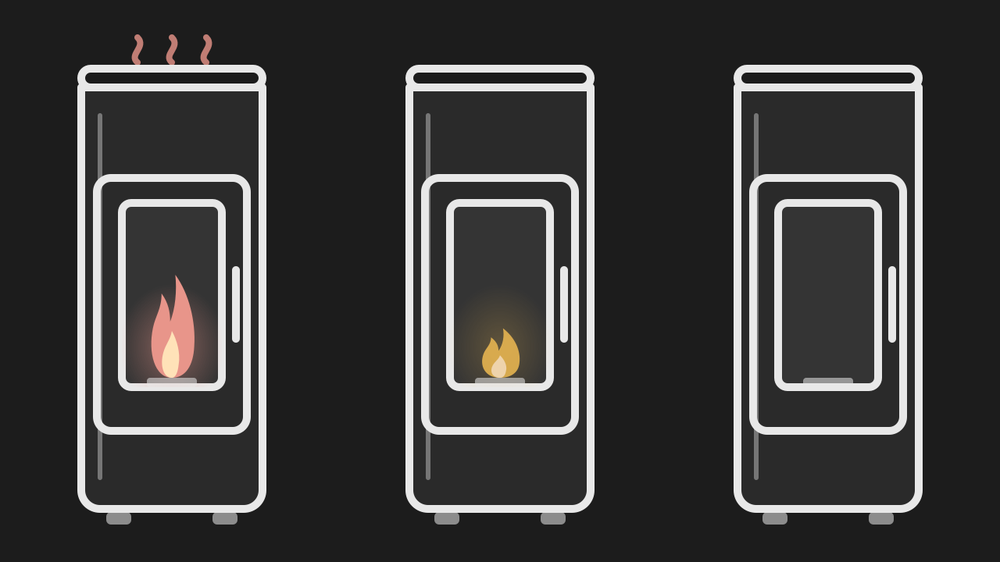

# Obs HA MCZ Maestro+

Carte Lovelace pour Home Assistant dédiée aux **poêles à pellets MCZ pilotés par Maestro+**, basée sur l'intégration [Robbe-B/maestro_mcz](https://github.com/Robbe-B/maestro_mcz).

Elle reprend le thème et les chevrons de [Thermostat Card – Bosch BTH-RA](https://github.com/Obseb/Thermostat-Card-Bosch-BTH-RA), en **deux fois plus haute** (10 lignes de grille par défaut au lieu de 4 à 5) et à la **même largeur** (6 colonnes).



*Illustration du poêle (inspirée du MCZ Mood) : chauffe, allumage, arrêt.*

## Ce que montre la carte

De haut en bas :

1. **En-tête** : badge rond (icône de l'entité, cliquable) + nom du poêle + état en cours (*Chauffe en cours*, *Allumage en cours*, *En veille*, *Extinction en cours*, *Éteint*, *Alarme*). À droite, l'**interrupteur Off ⇄ Chauffe** (`off` ⇄ `heat`).
2. **3 cases alignées** :
   - **Préréglage** : `manual`, `auto`, `overnight`, `comfort`, `turbo` (selon le modèle). Un appui ouvre la liste.
   - **Ventilo 1** et **Ventilo 2** : niveau actuel (ex. `3/5`) ou mode (Auto…). Un appui ouvre les niveaux, les modes et « Arrêt ». L'icône tourne d'autant plus vite que le niveau est élevé.
3. **Grande illustration de poêle** (style icônes Home Assistant, inspirée du MCZ Mood) animée selon l'état :
   grande flamme fine en chauffe, petite flamme pendant l'allumage, braises en veille, vitre vide à l'arrêt, air chaud qui monte quand un ventilateur tourne.
4. **Température actuelle** (grande, colorée selon l'état) et **consigne** avec les chevrons ▲ / ▼ (envoi différé de 0,9 s, comme la carte Bosch).

### Fonctions ajoutées (autour du poêle)

Ces pastilles sont **détectées automatiquement** et n'apparaissent que si l'entité existe :

| Pastille | Entité de l'intégration | Action |
| --- | --- | --- |
| 🌡 Température des fumées | `sensor.<poele>_exhaust_temperature` | lecture |
| 💧 Température de l'eau (modèles hydro) | `sensor.<poele>_water_temperature` | lecture |
| 🔧 Heures avant entretien (jaune ≤ 20 h) | `sensor.<poele>_next_maintenance` | lecture |
| 🔥 Puissance manuelle | `select.<poele>_manual_power` | ouvre la liste des niveaux |
| 🍃 Éco (Start & Stop) | `switch.<poele>_start_stop` | bascule |
| ⏱ Chrono | `switch.<poele>_timer` | bascule |
| ⚠ Bandeau d'alarme + code + bouton **Réinitialiser** | `binary_sensor.<poele>_alarm`, `sensor.<poele>_last_alarm_code`, `button.<poele>_alarm_reset` | réinitialise l'alarme |

`<poele>` est le nom de votre entité `climate` (par exemple `climate.stufa` → `sensor.stufa_exhaust_temperature`). Si vos entités ont un autre nom, la carte cherche aussi parmi les entités du **même appareil** d'après leur nom affiché, et vous pouvez toujours les indiquer à la main (voir ci-dessous).

## Installation via HACS

1. HACS → ⋮ → **Dépôts personnalisés**.
2. Ajoutez `https://github.com/Obseb/Obs-HA-MCZ-MaestroPlus`, catégorie **Dashboard** (ou « Lovelace » selon la version).
3. Installez **Obs HA MCZ Maestro+**, puis rechargez le navigateur (Ctrl+F5).

Si la ressource n'est pas ajoutée automatiquement : *Paramètres → Tableaux de bord → ⋮ → Ressources* → ajoutez `/hacsfiles/Obs-HA-MCZ-MaestroPlus/obs-ha-mcz-maestroplus.js` (type **Module JavaScript**).

## Installation manuelle

Copiez `obs-ha-mcz-maestroplus.js` dans `/config/www/` et ajoutez la ressource `/local/obs-ha-mcz-maestroplus.js` (Module JavaScript).

## Configuration

Le plus simple :

```yaml
type: custom:obs-ha-mcz-maestroplus
entity: climate.stufa
name: Poêle salon
```

Tout le reste est détecté automatiquement. Un éditeur visuel est aussi disponible.

| Option | Type | Défaut | Description |
| --- | --- | --- | --- |
| `entity` | string | **requis** | Entité `climate.xxx` de l'intégration Maestro MCZ |
| `name` | string | nom de l'entité | Titre de la carte |
| `icon` | string | icône de l'entité | Icône du badge (ex. `mdi:fire`) |
| `tap_action` | action | `more-info` | Action au clic sur le badge (voir ci-dessous) |
| `image` | string | dessin intégré | URL d'une image à afficher à la place du dessin du poêle (ex. `/local/mood.png`) |
| `heat_mode` | string | `heat` | Mode activé par l'interrupteur |
| `step` | number | `0.5` | Pas consigne de température |
| `show_status` | boolean | `true` | Affiche l'état sous le nom |
| `show_chips` | boolean | `true` | Affiche les pastilles autour du poêle |
| `fan1`, `fan2` | entity | auto | Entités `fan` des ventilateurs 1 et 2 |
| `power` | entity | auto | Entité `select` de la puissance manuelle |
| `eco`, `timer` | entity | auto | Entités `switch` Start & Stop et Chrono |
| `exhaust_temp`, `water_temp`, `maintenance` | entity | auto | Entités `sensor` |
| `alarm`, `alarm_code`, `alarm_reset` | entity | auto | Alarme (`binary_sensor`, `sensor`, `button`) |

Pour masquer une pastille ou une case, mettez son option à `false` (ex. `fan2: false`, `timer: false`).

### Action du badge

Le badge rond en haut à gauche est cliquable. Dans l'éditeur visuel, choisissez **Action au clic sur le badge** : *Aucune*, *Plus d'infos* (par défaut), *Naviguer*, *URL* ou *Effectuer une action*. En YAML :

```yaml
tap_action:
  action: more-info            # none | more-info | navigate | url | perform-action
```

```yaml
tap_action:
  action: navigate
  navigation_path: /lovelace/chauffage
```

```yaml
tap_action:
  action: url
  url_path: https://exemple.fr
```

```yaml
tap_action:
  action: perform-action
  perform_action: script.turn_on
  target:
    entity_id: script.allumer_poele
  data: {}
```

### Taille et mise en page

Les dimensions du nom, du badge, de l'interrupteur, de la température actuelle, de la consigne et des chevrons sont **identiques à celles de la carte [Thermostat Card – Bosch BTH-RA](https://github.com/Obseb/Thermostat-Card-Bosch-BTH-RA)** : elles utilisent le même système d'unités et la même largeur de référence. À largeur égale, les deux cartes ont donc les mêmes proportions.

Dans une vue **Sections**, la carte suit le réglage **Mise en page** : elle occupe exactement les lignes et colonnes choisies (10 lignes × 6 colonnes par défaut, 6 lignes au minimum).
- Ajouter des lignes agrandit le poêle, qui occupe toute la hauteur disponible.
- Élargir la carte ne change pas sa hauteur.
- Si la hauteur est trop faible pour tout afficher, l'ensemble est réduit proportionnellement.
- Quand la carte fait **deux fois la hauteur** d'une carte Bosch de même largeur (ex. 8 lignes contre 4), le nom, l'interrupteur, les températures et les chevrons ont **exactement la même taille** que sur la carte Bosch, même si celle-ci est réduite par sa hauteur. Au-delà (ex. 10 lignes), la carte s'agrandit jusqu'à la largeur de référence.

Dans les autres vues, la carte garde sa hauteur naturelle.

### Exemple complet

```yaml
type: custom:obs-ha-mcz-maestroplus
entity: climate.stufa
name: Poêle salon
fan1: fan.stufa_fan_1
fan2: fan.stufa_fan_2
power: select.stufa_manual_power
eco: switch.stufa_start_stop
timer: switch.stufa_timer
exhaust_temp: sensor.stufa_exhaust_temperature
maintenance: sensor.stufa_next_maintenance
water_temp: false
```

### Personnalisation du thème

Variables CSS utilisables (ex. avec card-mod) : `--htc-card-bg`, `--htc-tile-bg`, `--htc-stove` (couleur du trait du poêle), `--htc-menu-bg`.

## Notes sur l'intégration Maestro MCZ

- Le mode du `climate` n'a que deux valeurs : `off` et `heat`. Le détail (allumage, veille, extinction) vient de `hvac_action`, que la carte traduit en texte et en animation.
- Les ventilateurs ne sont disponibles que si le **préréglage du poêle** les autorise : la case est grisée sinon.
- Les ventilateurs sont des entités `fan` : le niveau est envoyé en pourcentage avec la même formule que Home Assistant, et les modes (`auto`…) via `fan.set_preset_mode`.
- Le nombre de préréglages et de niveaux dépend du modèle (M1, M2, M3) : la carte lit simplement ce que l'entité expose.

## Publier sur GitHub pour HACS

Créez d'abord le dépôt vide `Obs-HA-MCZ-MaestroPlus` sur GitHub, puis, depuis ce dossier :

```
git remote add origin https://github.com/Obseb/Obs-HA-MCZ-MaestroPlus.git
git push -u origin main
```

Ajoutez une **description** et des **topics** (`home-assistant`, `hacs`, `lovelace`, `mcz`), puis créez une **release** (ex. `v1.0.0`) : HACS s'en sert pour les versions. Le workflow `.github/workflows/validate.yml` vérifie la structure du dépôt.
